# Assertly

A hands-on QA practice platform. Testers work the whole job (requirement, test plan, test cases, execution, bug reports, test summary) against realistic systems that contain hidden, seeded bugs, and get scored on what they find.

> **Status: live since 2026-11-07. Phases 0 to 4 are done and the launch phase is nearly done.** The site is public, with the first-run tour, PDF export and docs. Still to come: the case study write-up. The optional AI feedback in the original plan has not been built; scoring and matching do not need it. Today the workspace, four practice systems with scored hidden defects (40 in all), accounts and saving, share links, the test plan editor, exploratory sessions and the traceability matrix all work. See [docs/ARCHITECTURE.md](docs/ARCHITECTURE.md).

**Live: https://assertly.vercel.app** (free hosting: Vercel and Neon).

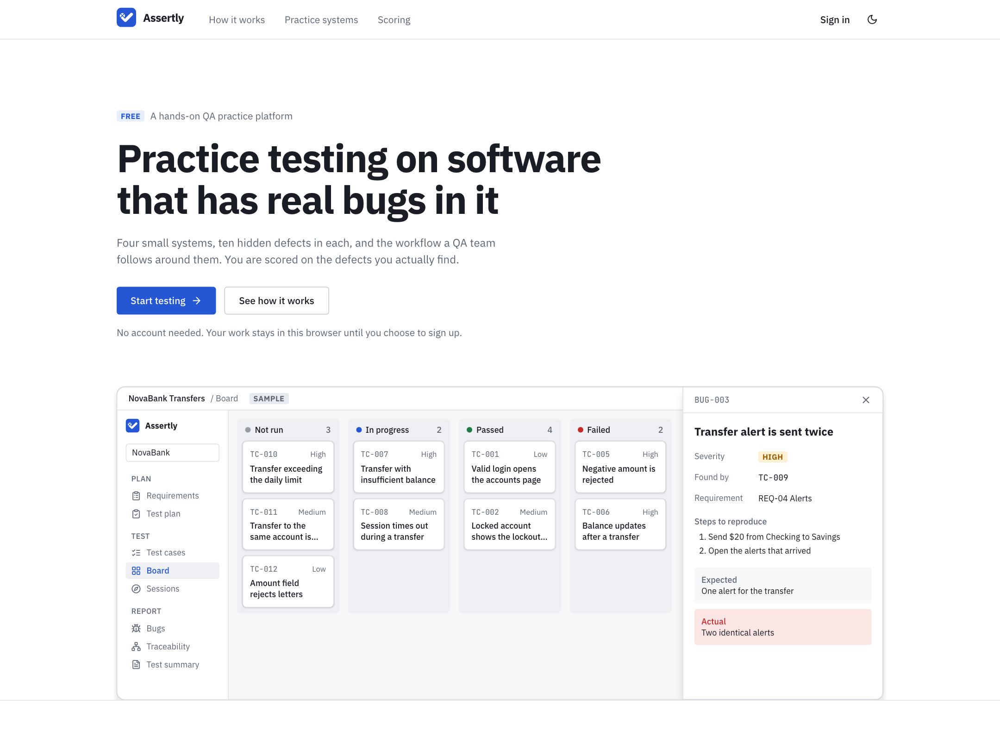

## Screenshots

NovaBank after an afternoon of testing: three of its ten hidden defects found and reported, two more triggered but not yet reported, a plan, an exploratory session, and a look at the other three systems. The pictures are made by `npm run screenshots`, which tells that story through the real screens and checks it before taking them.

<table>
<tr>
<td width="50%">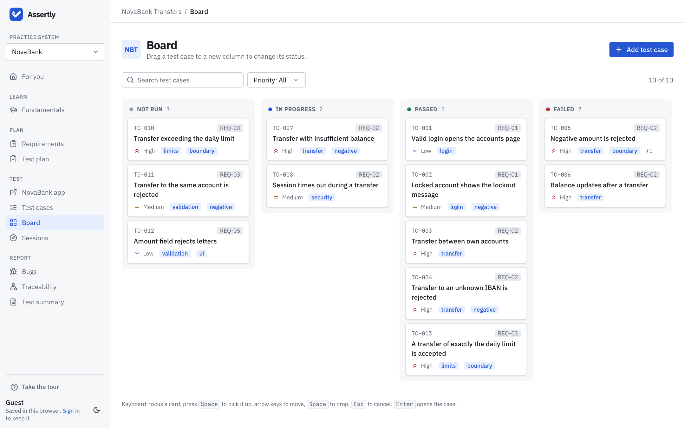<br><sub><b>Board.</b> Test cases as columns by status. Drag a card, or use the keyboard.</sub></td>
<td width="50%">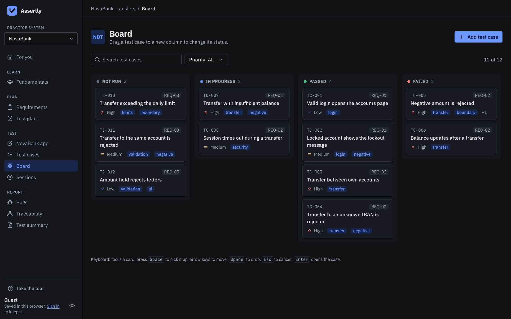<br><sub><b>Dark theme.</b> Black and blue; the light theme is white and blue.</sub></td>
</tr>
<tr>
<td>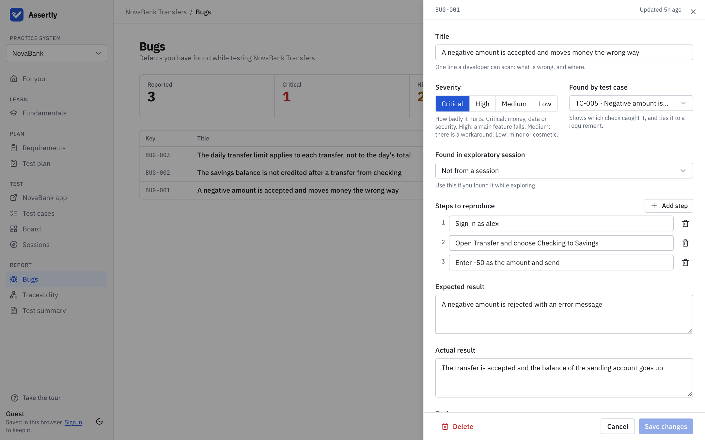<br><sub><b>A bug report</b>, linked to the test case that found it.</sub></td>
<td>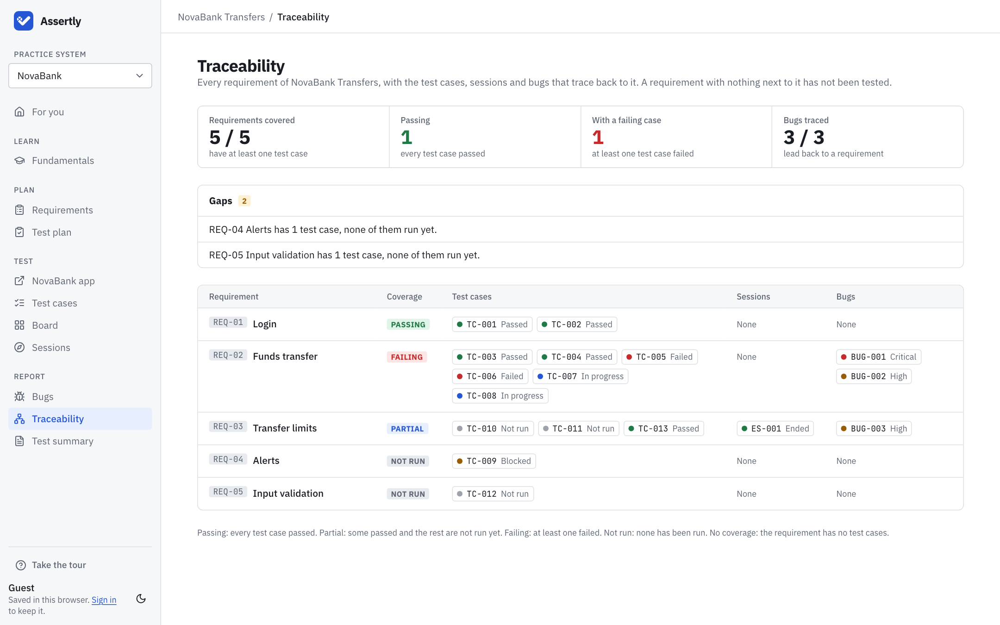<br><sub><b>Traceability.</b> Every requirement with the tests, sessions and bugs behind it, and what is still uncovered.</sub></td>
</tr>
<tr>
<td>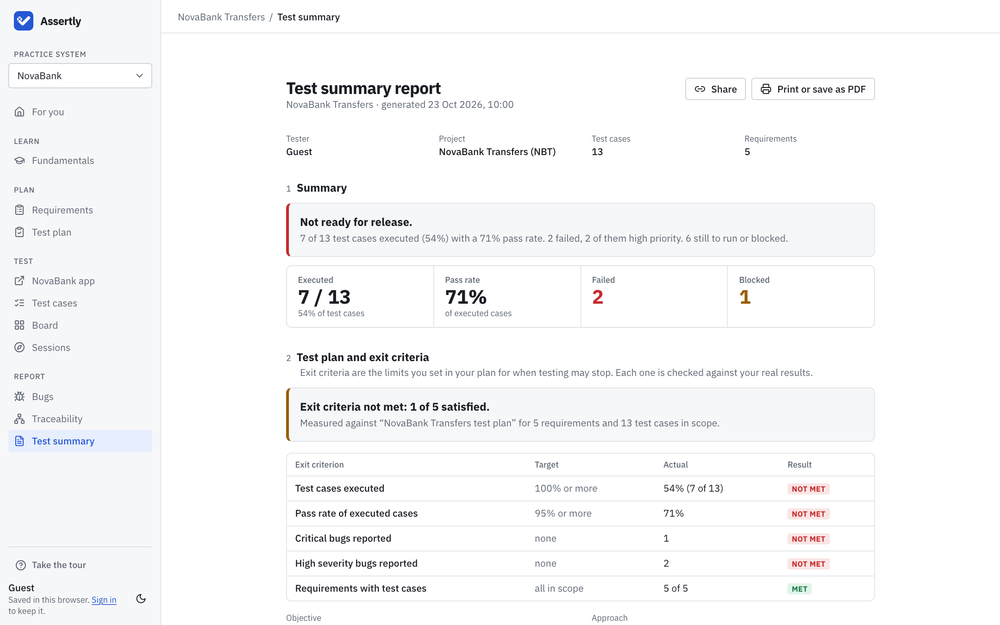<br><sub><b>Test summary.</b> A verdict, the results, and the plan's exit criteria checked against them.</sub></td>
<td>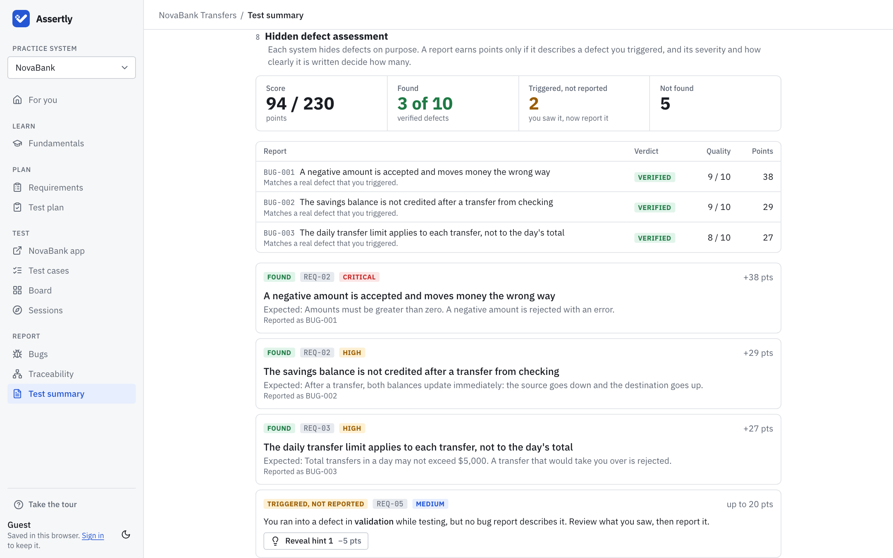<br><sub><b>The score.</b> Three verified defects, two triggered but not reported, five not found. Points depend on severity and on how well each report is written.</sub></td>
</tr>
<tr>
<td>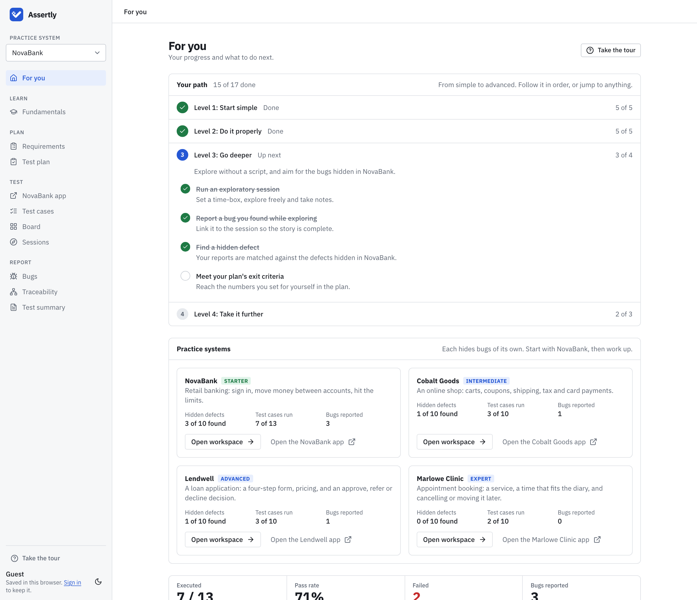<br><sub><b>Your path</b> from simple to advanced, ticked off by what you actually did, and progress in each practice system.</sub></td>
<td>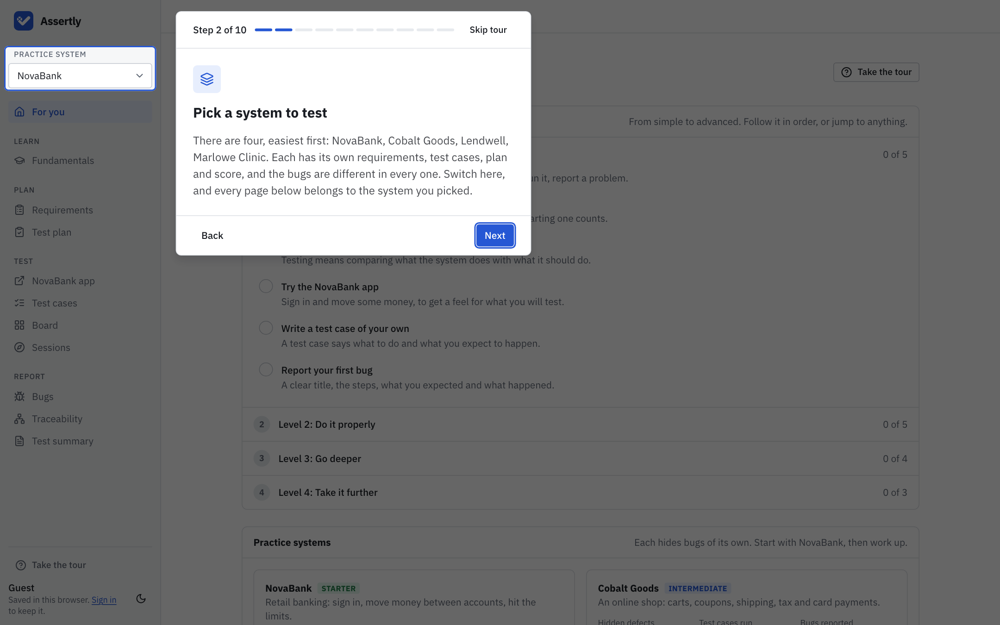<br><sub><b>The tour</b> is about the system you are on, and points at the real sidebar item.</sub></td>
</tr>
<tr>
<td>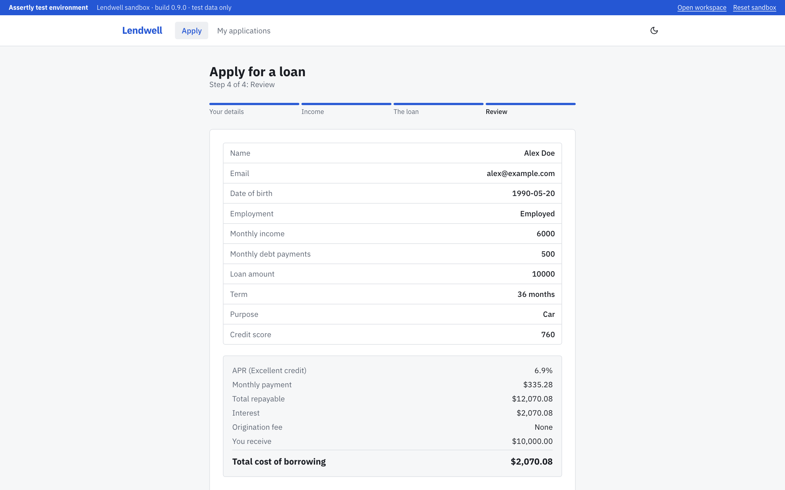<br><sub><b>Lendwell</b> (advanced): a loan application with a live quote, where the defects hide in boundaries and calculations.</sub></td>
<td>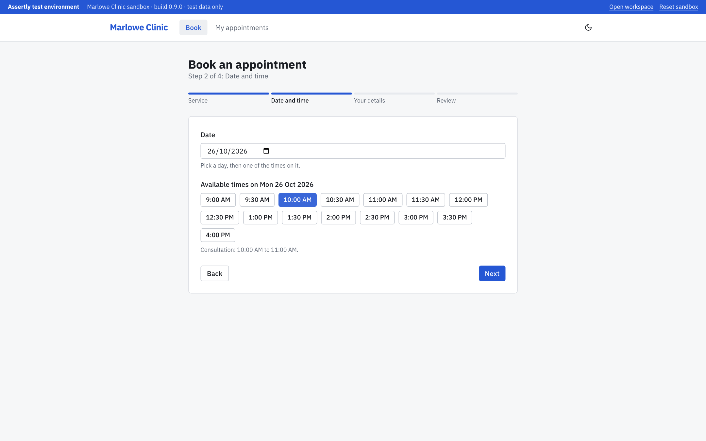<br><sub><b>Marlowe Clinic</b> (expert): appointment booking, where the defects depend on dates and the diary.</sub></td>
</tr>
</table>

## What works today

- **Landing page** (`/`): the front door. What Assertly is, the workflow it follows, the practice systems (read from the same registry as the app, so a new system appears by itself), how scoring works, and a way in with no account. It never redirects: someone who is signed in sees a link to their workspace instead of "Sign in".
- **App shell:** sidebar, top bar, light and dark themes, responsive down to phone width.
- **Fundamentals track** (`/learn`): 12 challenges where you discover every validation behavior. Progress is saved in your browser, no sign-up.
- **Test plan** (`/app/novabank/plan`): scope, approach, types of testing, entry criteria, risks and measurable exit criteria (execution percentage, pass rate, limits on critical and high bugs, requirement coverage). Start from a template. The test summary then checks your real results against the plan's exit criteria.
- **Exploratory sessions** (`/app/novabank/sessions`): time-boxed, charter-led testing. Plan a session (charter, an optional requirement to explore, 15 to 90 minute time-box), start the clock, take timestamped notes (observation, question, risk, test idea) with the keyboard, report bugs from it, and write a debrief. The timer warns when time is nearly up and when the time-box is reached. Sessions appear in the test summary.
- **Test cases** (`/app/novabank/cases`): a sample banking project you can edit. Search, filter, sort, bulk actions, and a drawer to write test cases with steps and expected results. Keyboard friendly: `J`/`K` move, `Enter` open, `P`/`F`/`B` pass, fail or block, `X` select, `C` new, `/` search. Every change has an Undo.
- **Board** (`/app/novabank/board`): the same test cases as columns by status. Drag a card to change its status or reorder it, with the mouse, touch or keyboard (`Space` to pick up, arrows to move, `Space` to drop, `Esc` to cancel). Every move has an Undo.
- **Test summary** (`/app/novabank/report`): a live report built from your results: a verdict (ready, incomplete, not ready), execution results, a requirement coverage matrix, failed test cases, risks and recommended next steps. Print it or save it as a PDF (always light, with the app chrome hidden).
- **Traceability** (`/app/novabank/traceability`): a matrix with one row per requirement and, beside it, the test cases, exploratory sessions and bugs that trace back to it, each a link that opens the item. A bug is traced through the test case or session it was found in. Above it, the gaps: requirements with no test cases, test cases nobody has run, failures with no bug reported against them. Anything that cannot be traced is listed apart.
- **Requirements** (`/app/novabank/requirements`): the written specification with acceptance criteria and the test cases linked to each requirement. Test against this, not against what you see on screen.
- **Practice systems:** pick which system you are testing from the sidebar. **NovaBank** (starter) is a bank with ten hidden defects. **Cobalt Goods** (intermediate) is an online shop with ten of its own: a cart, coupons, shipping, tax, card payments and orders (`/sandbox/shop`, test cards are shown on the checkout page; no real payment is ever taken). **Lendwell** (advanced) is a loan application: a four-step form, a live quote, an approve / refer / decline decision, and a list of applications (`/sandbox/loans`), where the defects hide in boundaries, calculations and going back and forward. **Marlowe Clinic** (expert) is an appointment booking system (`/sandbox/booking`): services, opening hours and closed days, a diary that fills up, a rule about how much notice a cancellation needs, and rescheduling. Its defects depend on the date and the time now, so it uses your computer's clock as the clinic's clock. Each system has its own requirements, starter test cases, plan template, session charters and answer key, and your score for one never counts for the other. The home page shows your progress in each.
- **NovaBank sandbox** (`/sandbox/novabank`): a practice banking app (sign in, accounts, transfers, activity) with ten defects hidden in it. Test credentials are shown on the sign-in page. "Reset sandbox" restores the accounts but keeps the log of defects you have triggered.
- **Bugs** (`/app/novabank/bugs`): report what you find with a title, severity, reproduction steps and expected and actual results. From a failed test case, "Report a bug" opens the form prefilled.
- **Scoring** (in the test summary): each report is matched to a hidden defect by its wording, and only counts if the sandbox saw you trigger that defect. Points depend on severity and on how well the report is written. Duplicates earn nothing. Hints are available for defects you have not found and cost 5 points each.
- **Tour and Your path** (`/app`): a ten-step, skippable walkthrough opens the first time you reach the home page ("Step 3 of 10", Back, Next, Skip, arrow keys work) and can be reopened from the sidebar. It is about the system you are on, so reopened on another system's page it names that system and links to its pages, and it has steps for choosing a system and for the traceability matrix. Each step dims the page and highlights the real sidebar item it is about, and the highlight glides from one item to the next. Under it, **Your path** lists what to do from simple to advanced in four levels, and ticks each step off by what you actually did: nothing is locked, it just shows where to go next. The skills count in any system, and the last level asks for a hidden defect in each of the other systems. The sidebar follows the same order: Plan, Test, Report, with the practice app one click away.
- **For you** (`/app`): your test run status, Fundamentals progress and what to do next.

- **Accounts and saving** (`/sign-in`, `/sign-up`): optional. As a guest your work stays in this browser. Sign up and it is saved to your account and follows you to any device; whatever you did as a guest becomes your workspace. Sign out and this browser is cleared. Email and password work out of the box; GitHub sign-in is on at the live site and turns on elsewhere when you configure it. The account page (`/account`) changes your name and password, signs your other devices out, and deletes the account with everything saved to it, including your share links. Where an email provider is set up, a forgotten password is reset by email and a link sent at sign-up confirms the address; the live site does not have one yet (see Known limits).
- **Share links** (on the test summary): a public, read-only copy of your report that anyone can open without an account. Defects you have not found stay hidden in it. You can revoke a link at any time.

"Reset sample data" restores the starter project.

## Getting started

Requires Node 20.9 or newer.

```bash
npm install
npm run dev
```

Open the address that `next dev` prints (http://localhost:3000 by default). Accounts work locally with no setup: without a `DATABASE_URL`, Assertly runs its own embedded Postgres (PGlite) in `.data/`. See [.env.example](.env.example) for production settings.

| Script | What it does |
|---|---|
| `npm run db:generate` | Creates a migration after you change `lib/db/schema.ts` |
| `npm run db:migrate` | Applies migrations to the database in `DATABASE_URL` (production) |
| `npm run dev` | Start the dev server |
| `npm run build` | Production build |
| `npm run lint` | ESLint |
| `npm run typecheck` | TypeScript (strict) |
| `npm test` | Unit tests (Vitest) |
| `npm run check` | Lint, typecheck and unit tests together |
| `npm run e2e` | End-to-end and accessibility tests (Playwright; builds and serves the app on port 3100) |
| `npm run e2e:ui` | The same, in Playwright's interactive UI |
| `npm run screenshots` | Regenerates the pictures in `docs/screenshots` (builds the app on port 3200, tells one story through the real screens, and fails if it does not come out as told) |

The e2e suite starts its own servers in their own folders, so it never disturbs a dev server you have running: a production build in `.next-e2e-prod` on port 3100, a second server on that same build on 3102 with email switched off, and a dev server in `.next-e2e` on 3101. It includes a dev-mode console check, because React only reports hydration mismatches and misuse there.

CI runs lint, typecheck, unit tests, a production build and the end-to-end suite on every push. First time running e2e locally: `npx playwright install chromium`.

## Stack

Next.js (App Router), React, TypeScript (strict), Tailwind CSS, Radix primitives, react-hook-form + zod, sonner, IBM Plex Sans and JetBrains Mono via `next/font`, `@dnd-kit` for the board, Better Auth for accounts (email and password, and GitHub), Drizzle with Postgres (Neon in production, an in-memory PGlite database in development and tests), Vitest and Playwright. Hosted on Vercel and Neon, both on their free plans. Everything is free to run.

## Project layout

```
app/               routes (thin)
  (shell)/         pages that share the app shell: /app, /learn, /learn/[slug], /account
  (auth)/          sign-in, sign-up, forgot and reset password
  api/             auth (Better Auth), workspace (saving), onboarding, share links
  sandbox/         the practice systems themselves
components/
  shell/           sidebar, top bar, theme toggle, the sync controller
  learn/           Fundamentals UI (table, progress panels)
  workspace/       test cases table, board and case drawer
  challenges/      the 12 challenge components
  account/, auth/  the account page and the sign-in forms
  onboarding/      the tour and "Your path"
  ui/              design-system primitives
hooks/             client hooks
lib/
  learn/           challenge catalog, scenarios, detection, progress, local store
  workspace/       test case and bug models, reducer, selectors, form schemas, scoring, requirements, seed data, local store
  sandbox/, systems/  the seeded-defect registries (answer keys), the app engines and their browser stores
  db/, share/      the database schema and repository, and share-link snapshots
  persistence/     saving to the account, and clearing this browser at sign-out
  onboarding/      the tour and path flags, and their account sync
  email/           password-reset and confirmation mail (Resend, or a test outbox)
  auth.ts          the Better Auth configuration
  actions.ts       server actions that validate each challenge
drizzle/           database migrations (run on every deploy)
docs/              ARCHITECTURE.md, design/, screenshots/ (generated: see npm run screenshots)
scripts/           brand assets, and screenshots/ (the generator behind docs/screenshots)
tests/             unit tests (Vitest) and e2e/ (Playwright, including automated accessibility scans)
```

## Design

Tokens, density and component rules come from [docs/design/mockup-v4.html](docs/design/mockup-v4.html): neutral surfaces, blue only for primary actions and selection, status colors only for meaning, hairline borders, small radius.

## Known limits

- The rate limit on the Fundamentals challenge submissions is shared by every visitor (one in-memory counter), and it is not per-session yet.
- `npm audit` reports 12 moderate advisories (none high or critical) that trace to two build-time packages: `esbuild` (inside `drizzle-kit`) and `minimatch` (inside the TypeScript-ESLint helpers). Neither is imported by the app or present in its production build. Clearing them means forced downgrades (`drizzle-kit` 0.18.1, `eslint-config-next` 15.5.29), so they are left. A non-breaking `npm audit fix` on 2026-11-14 cleared the other three (`fast-uri`, `glob`, `postcss-selector-parser`).
- The hidden-defect answer key ships with the app (and the repository is public), so a determined user can read it. That is fine for a practice tool. A share link never contains it, but scores are computed from data the browser sends, so a shared score is not tamper-proof.
- Visits to the live site are counted with Vercel Web Analytics (no cookies, nothing personal); it loads nowhere else.
- Password reset and email confirmation are built and tested, and switch on when an email provider is configured (`RESEND_API_KEY`, `EMAIL_FROM` and `BETTER_AUTH_URL`: see `.env.example`). Until then the site does not offer them, and a forgotten password cannot be recovered. One real test email has gone through Resend's testing sender to its owner's own address and was delivered. Nobody else can be emailed until a domain is verified, so the live site keeps this switched off.
- Signing out clears this browser's copy of everything. The tour's "dismissed" flag and which pages you have opened are saved in your account, so signing back in (or opening the site on another device) does not show the tour again or un-tick "Your path"; a guest's flags are added to the account when they sign up.
- GitHub sign-in works on the live site (first real sign-in: 2026-11-07). An email that already has an unconfirmed password account is refused with a clear message (tried on the live site with the real GitHub); and while email is off nobody can confirm an email, so such people sign in with their password.
- Conflicts between two devices editing at once are resolved by taking the newer saved copy; the other device is told it was updated.

## License

Released under the [MIT license](LICENSE).
